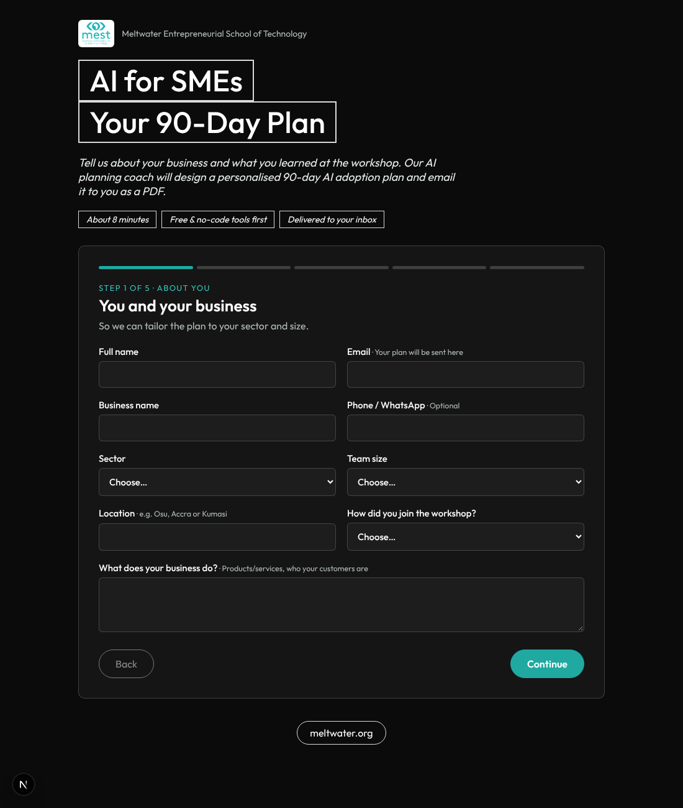

# MEST Africa · AI for SMEs: 90-Day Plan Generator

This web app goes with the **MEST Africa "AI for SMEs" Workshop** (6 November 2026). SME owners fill in a 5-step form about their business, their pain points and their workshop takeaways. A Claude-powered planning agent then writes a **personalised 90-day AI adoption plan**. The app turns the plan into a branded **PDF** and **emails it to the owner**. The owner can also download it on the spot.



`docs/sample-plan-mock-data.pdf` shows the PDF layout, filled with placeholder data.

## How it works

```
Form (5 steps)  →  POST /api/plan
                   ├─ Input guardrails: schema validation, sanitising, honeypot, rate limits, prompt-injection screen
                   ├─ Planning agent (Claude Opus 5.5, structured JSON output)
                   │    · system prompt built from the concept note: Modules 1–5, partners Oze / Kudobuzz / Intelli
                   │    · respects the owner's budget, weekly hours, devices and AI familiarity
                   │    · scope check: rejects non-genuine or harmful businesses and injection attempts
                   ├─ Output guardrails: 3 phases covering weeks 1–13, 3–5 processes, KPIs, safeguards,
                   │    and a ban on guaranteed results, fake reviews, scraped contact lists, pirated software, etc.
                   │    → one self-correction retry, then fail closed
                   ├─ PDF (@react-pdf/renderer, MEST branding)
                   ├─ Email with the PDF attached (Resend), optional BCC to a MEST inbox
                   └─ Optional lead webhook (Google Sheet / Airtable via Zapier, Make or Apps Script)
```

The form follows the workshop agenda:
1. **About you**: business, sector, location, team size, how you attended
2. **Starting point**: AI familiarity, channels, current tools, devices, budget, time available
3. **Pain points**: back-office (Module 2), marketing (Module 3), customer engagement (Module 4)
4. **Takeaways**: the 3 processes to automate (the workshop objective), most useful sessions, concerns
5. **Goals**: main 90-day goal, what success looks like, consent

Each PDF contains: a summary, strengths and opportunities, quick wins for this week, 3–5 priority processes with tools and costs, a week-by-week roadmap for weeks 1–13 in 3 phases, KPIs, a budget in GHS, responsible-AI safeguards (including Ghana's Data Protection Act, 2012 (Act 843)), skills to build, and next steps with MEST.

## Deploy to Vercel

1. Push this folder to a GitHub repository.
2. In Vercel, choose **Add New → Project**, import the repository, and keep the defaults (Next.js is detected automatically).
3. Add these **Environment Variables**:

   | Variable | Required | Notes |
   |---|---|---|
   | `ANTHROPIC_API_KEY` | ✅ | From console.anthropic.com |
   | `RESEND_API_KEY` | ✅ for email | From resend.com |
   | `EMAIL_FROM` | ✅ for email | e.g. `MEST Africa <ai-for-smes@meltwater.org>`. The domain must be verified in Resend. |
   | `EMAIL_BCC` | optional | MEST inbox that gets a copy of every plan |
   | `LEADS_WEBHOOK_URL` | optional | Receives each submission as JSON. Use it to build the SME lead list. |
   | `RATE_LIMIT_PER_HOUR` | optional | Requests per IP per hour (default 5) |

4. Click **Deploy**.

Notes:
- Writing a plan takes about 1–2 minutes. The API route sets `maxDuration = 300`, which needs Vercel **Fluid Compute** (on by default for new projects). On a plan with a lower limit, raise the function duration in Project Settings → Functions.
- Without `RESEND_API_KEY` the app still works: users see the "download PDF" option instead of email delivery.
- The rate limiter keeps its counts in each serverless instance's memory, so it is approximate. For strict limits on a high-traffic launch, move it to Vercel KV or Upstash Redis (`lib/guardrails.ts`).
- On 6 November many participants submit from the same venue Wi-Fi, so they share one IP. Before the event, raise `RATE_LIMIT_PER_HOUR` (for example to `200`). The per-email limit of 3 per hour still applies.

## Local development

```bash
cp .env.example .env.local   # fill in ANTHROPIC_API_KEY (and Resend if you want to test email)
npm install
npm run dev                  # http://localhost:3000
```

## Project layout

```
app/page.tsx              Landing page and hero (styled like the workshop flyer)
components/PlanForm.tsx   5-step form, loading and result screens, PDF download
app/api/plan/route.ts     Pipeline: validate → agent → PDF → email → lead webhook
lib/schema.ts             Form options, form schema, AI output schema
lib/agent.ts              System prompt and Claude call (structured output, refusal fallback, self-correction)
lib/guardrails.ts         Input, prompt and output guardrails, rate limiting
lib/pdf.tsx               Branded PDF document
lib/email.ts              Email template and sending
```
